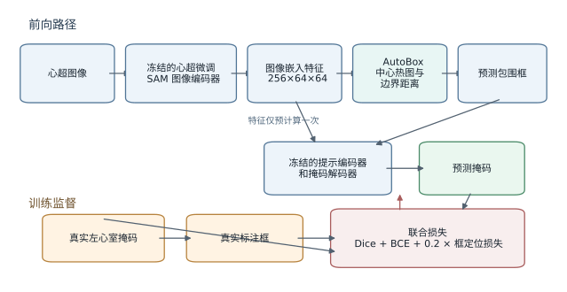
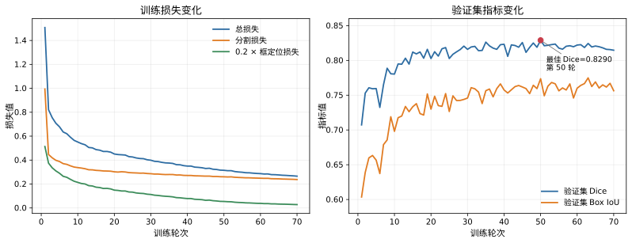
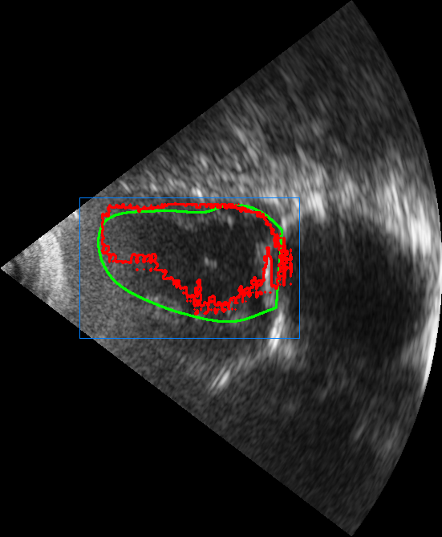

<div align="center">

# EchoTextSeg

### 基于自动包围框提示的 SAM-Echo 左心室全自动分割

将原本依赖人工或真实标注框的 SAM-Echo，改造成从超声心动图直接预测左心室分割掩码的自动流程。


</div>

## 项目简介

SAM-Echo 在心脏超声图像上具有较好的左心室分割能力，但它仍需要外部包围框提示。实际应用中并不存在由真实掩码生成的 GT Box，因此本项目设计了轻量级 **AutoBox**：它读取冻结的 SAM-Echo 图像特征，预测左心室中心响应图和 LTRB 距离图，再自动生成 Box Prompt 并驱动 SAM-Echo 输出分割掩码。

训练时使用可微的 soft-argmax 生成软包围框，使掩码分割误差能够反向传播至 AutoBox；推理时使用 argmax 生成确定包围框。SAM-Echo 全程冻结，只训练 AutoBox，因此可在 6 GB 显存的 RTX 3060 上完成实验。

<p align="center">
  
</p>

## 主要特点

- **自动提示**：测试时只输入心超图像，不需要 GT Box、真实掩码或人工交互。
- **面向分割结果训练**：联合优化 Dice、BCE 与 Box Loss，避免只追求框的位置准确而忽略最终掩码质量。
- **低显存训练**：冻结 SAM-Echo 并预先缓存图像嵌入，只训练约 1M 参数的 AutoBox。
- **完整复现流程**：包含 CAMUS 数据检查、特征缓存、模型训练、GT Box 参考评估、自动框评估和结果汇总脚本。
- **提供训练权重**：仓库内附联合损失模型的最佳 AutoBox 检查点，可直接用于评估或继续训练。

## 实验结果

实验使用 CAMUS 官方划分：400 位患者训练、50 位患者验证、50 位患者测试。每位患者使用 A2C、A4C 视图的 ED、ES 帧，目标为左心室心腔。A2C 与 A4C 先在患者内合并，再分别统计 ED 和 ES 结果。

| 方法 | ED Dice ↑ | ED IoU ↑ | ED HD95 ↓ | ED Box IoU ↑ | ES Dice ↑ | ES IoU ↑ | ES HD95 ↓ | ES Box IoU ↑ |
|---|---:|---:|---:|---:|---:|---:|---:|---:|
| SAM-Echo + GT Box | 0.8715 | 0.7761 | 8.59 mm | 1.0000 | 0.8355 | 0.7220 | 8.09 mm | 1.0000 |
| AutoBox（仅 Box Loss） | 0.8348 | 0.7214 | **10.20 mm** | **0.7923** | 0.7871 | 0.6568 | 10.38 mm | 0.7658 |
| **AutoBox（联合损失）** | **0.8376** | **0.7262** | 10.48 mm | 0.7869 | **0.8034** | **0.6774** | **10.24 mm** | **0.7662** |

GT Box 使用真实掩码产生的框，只表示目标位置已知时的参考结果，不属于全自动系统。与仅使用 Box Loss 相比，联合损失主要改善了更困难的 ES 分割；ED 的 HD95 和 Box IoU 没有同步提高，因此不宣称所有指标均有改善。完整的均值、标准差与逐帧结果见 [实验结果说明](docs/EXPERIMENT_RESULTS.md)。

<p align="center">
  
</p>

<p align="center">
  <br>
  <sub>定性示例：蓝色为自动预测框，绿色为真实轮廓，红色为预测轮廓。</sub>
</p>

## 项目结构

```text
EchoTextSeg/
├── assets/                         # GitHub 首页使用的结构图与结果图
├── configs/                        # 数据、模型和训练配置
├── data/                           # 数据说明与检查报告，不含 CAMUS 原始数据
├── docs/                           # 实验结果、复现记录和项目决策
├── scripts/                        # 检查、缓存、训练、评估和制表入口
├── src/                            # 数据读取、AutoBox、SAM-Echo 封装、损失和指标
├── tests/                          # 轻量组件测试
├── weights/                        # 本项目训练得到的 AutoBox 权重
├── environment.yml                 # Conda 环境配置
├── requirements.txt                # Python 依赖
└── README.md
```

数据集、特征缓存、SAM-Echo 官方大权重、训练日志、第三方仓库和报告草稿均由 `.gitignore` 排除，不会在执行 `git add .` 时被误上传。

## 环境安装

建议使用带有 CUDA 支持的 NVIDIA GPU。项目实际在 Windows、Python 3.9、PyTorch 2.8 和 RTX 3060 6 GB 环境中完成。

```bash
git clone <你的仓库地址>
cd EchoTextSeg
conda env create -f environment.yml
conda activate echo-autobox
```

`environment.yml` 会安装本项目依赖以及 Meta 官方的 Segment Anything。若已有合适的 PyTorch 环境，也可以手动安装：

```bash
pip install -r requirements.txt
pip install "git+https://github.com/facebookresearch/segment-anything.git"
```

## 数据与权重准备

### 1. CAMUS 数据集

本仓库不分发 CAMUS 原始数据。下载数据后按以下结构放置：

```text
dataset/CAMUS_public/
├── database_nifti/
│   ├── patient0001/
│   └── ...
└── database_split/
    ├── subgroup_training.txt
    ├── subgroup_validation.txt
    └── subgroup_testing.txt
```

如需使用其他位置，请修改 [实验配置](configs/experiment.yaml) 中的 `data.root`。

### 2. SAM-Echo 官方权重

从 [SAM-Echo 官方仓库](https://github.com/chiehjuchao/SAM-Echo)提供的下载地址获取 `sam_model_best.pth`，放到：

```text
checkpoints/sam_echo_official/sam_model_best.pth
```

该文件约 388 MB，超过 GitHub 普通仓库的单文件大小限制，因此本仓库不重复分发。

### 3. 本项目 AutoBox 权重

联合损失训练得到的最佳检查点位于 [`weights/autobox_segaware_best.pt`](weights/autobox_segaware_best.pt)：

- 最佳 epoch：50
- 验证集 Dice：0.8290
- 验证集 Box IoU：0.7737
- 文件大小：约 11.9 MB
- SHA256：`05B63C6824328D121B3F48E284649337033358A3D564D578434A32FC549B16F1`

## 快速开始

以下命令均在仓库根目录执行。

### 1. 检查环境与数据

```bash
python scripts/check_environment.py
python scripts/prepare_camus.py --config configs/experiment.yaml
python tests/test_components.py
```

### 2. 直接评估已训练的 AutoBox

确保 SAM-Echo 官方权重和 CAMUS 数据已放置，然后运行：

```bash
python scripts/evaluate_autobox.py \
  --config configs/experiment.yaml \
  --checkpoint weights/autobox_segaware_best.pt
```

Windows PowerShell 可以写成一行：

```powershell
python scripts\evaluate_autobox.py --config configs\experiment.yaml --checkpoint weights\autobox_segaware_best.pt
```

### 3. 从头训练 AutoBox

```bash
python scripts/cache_embeddings.py --config configs/experiment.yaml
python scripts/train_autobox.py --config configs/experiment.yaml
python scripts/evaluate_autobox.py --config configs/experiment.yaml
python scripts/make_table.py
```

Windows 下也可以运行完整流程：

```powershell
powershell -ExecutionPolicy Bypass -File scripts\run_train.ps1
```

训练采用以下联合损失：

```text
L = L_Dice + L_BCE + 0.2 × L_Box
```

最佳权重仅依据验证集掩码 Dice 保存。默认配置训练 100 个 epoch，也可以通过 `--epochs` 指定训练轮数。

### 4. 复现 GT Box 参考结果

```bash
python scripts/evaluate_gt_box.py --config configs/experiment.yaml
python scripts/make_table.py
```

GT Box 来源于真实测试掩码，仅用于分析 SAM-Echo 在理想提示下的分割能力，不能与全自动方法等价比较。

## 结果文件

- `results/main_table.csv`：三种设置的主结果表。
- `results/*/summary.csv`：患者级汇总结果。
- `results/*/per_frame_metrics.csv`：逐帧 Dice、IoU、HD95 和 Box IoU。
- `results/*/qualitative/`：自动框、真实轮廓和预测轮廓可视化。
- `logs/autobox_segaware_history.csv`：训练与验证历史。
- `docs/REPRODUCTION.md`：SAM-Echo + GT Box 本地复现说明。
- `docs/EXPERIMENT_RESULTS.md`：联合损失实验的完整分析。

## 使用说明

本项目用于课程实验与研究复现，不构成医疗器械或临床诊断工具。CAMUS 数据和 SAM-Echo 权重应分别遵守其原始发布方的使用条款；请勿将患者数据、未经授权的数据副本或包含隐私信息的文件提交到公开仓库。

## 第三方代码与致谢

- 本项目依赖 Meta AI Research 发布的 [Segment Anything](https://github.com/facebookresearch/segment-anything)。SAM 源代码采用 Apache License 2.0；本仓库不复制其完整代码，而是通过 Python 包调用 `sam_model_registry`、Prompt Encoder 和 Mask Decoder。
- [`src/models/sam_echo.py`](src/models/sam_echo.py) 的模型加载与推理流程参考并重新封装了 [SAM-Echo 官方仓库](https://github.com/chiehjuchao/SAM-Echo)公开的推理 Notebook。对应论文为 C.-J. Chao 等发表于 *npj Digital Medicine* 的 *Foundation versus domain-specific models for left ventricular segmentation on cardiac ultrasound*（2025，DOI: [10.1038/s41746-025-01730-y](https://doi.org/10.1038/s41746-025-01730-y)）。SAM-Echo 权重不随本仓库分发。
- 实验使用 [CAMUS](https://www.creatis.insa-lyon.fr/Challenge/camus/) 数据集。请引用 S. Leclerc 等发表于 *IEEE Transactions on Medical Imaging* 的 *Deep Learning for Segmentation Using an Open Large-Scale Dataset in 2D Echocardiography*（2019，DOI: [10.1109/TMI.2019.2900516](https://doi.org/10.1109/TMI.2019.2900516)）。本仓库不包含 CAMUS 原始数据。
