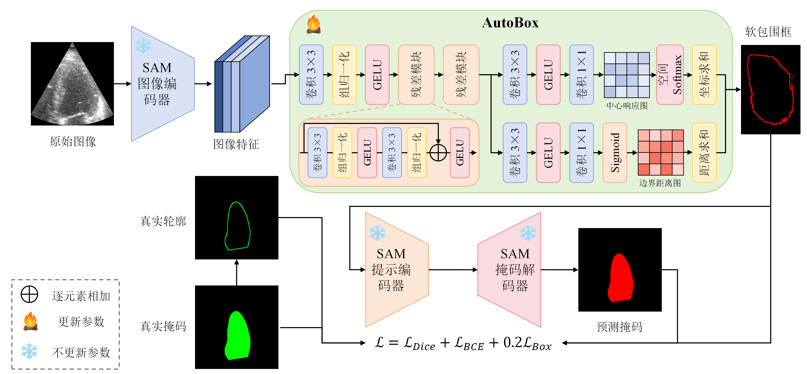

<div align="center">

# AutoBox

### 基于自动包围框提示的 SAM-Echo 左心室全自动分割


</div>

## 项目简介

SAM-Echo 能够根据 Box Prompt 分割心超图像中的左心室，但实际使用时通常没有现成的包围框。AutoBox 从冻结的 SAM-Echo 图像特征中自动预测左心室包围框，再调用原有的 Prompt Encoder 和 Mask Decoder 生成分割掩码，使推理过程不再依赖 GT Box 或人工交互。

<p align="center">
  
</p>

## 方法

- AutoBox 预测中心响应图以及中心到左、上、右、下边界的 LTRB 距离。
- 训练阶段使用可微 soft-argmax 生成软包围框，使分割损失能够传回 AutoBox。
- 推理阶段使用 argmax 生成确定包围框；SAM-Echo 参数始终冻结。

训练损失为：

```text
L = L_Dice + L_BCE + 0.2 × L_Box
```

## 实验结果

实验采用 CAMUS 官方 400/50/50 患者划分，使用 A2C、A4C 视图的 ED、ES 帧分割左心室心腔。

| 方法 | ED Dice ↑ | ED IoU ↑ | ED HD95 ↓ | ES Dice ↑ | ES IoU ↑ | ES HD95 ↓ |
|---|---:|---:|---:|---:|---:|---:|
| SAM-Echo + GT Box | 0.8715 | 0.7761 | 8.59 mm | 0.8355 | 0.7220 | 8.09 mm |
| AutoBox（仅 Box Loss） | 0.8348 | 0.7214 | **10.20 mm** | 0.7871 | 0.6568 | 10.38 mm |
| **AutoBox（联合损失）** | **0.8376** | **0.7262** | 10.48 mm | **0.8034** | **0.6774** | **10.24 mm** |

GT Box 是使用真实掩码生成的理想提示参考，不属于全自动方法。详细结果见 [实验结果说明](docs/EXPERIMENT_RESULTS.md)。

## 环境与数据

使用 Conda 创建环境：

```bash
conda env create -f environment.yml
conda activate autobox
```

CAMUS 数据放在 `dataset/CAMUS_public/`，SAM-Echo 官方 `sam_model_best.pth` 放在：

```text
checkpoints/sam_echo_official/sam_model_best.pth
```

本项目训练得到的 AutoBox 权重已经放在 [`weights/autobox_segaware_best.pt`](weights/autobox_segaware_best.pt)。

## 运行流程

以下命令均在仓库根目录执行：

```bash
python scripts/prepare_camus.py --config configs/experiment.yaml
python scripts/cache_embeddings.py --config configs/experiment.yaml
python scripts/train_autobox.py --config configs/experiment.yaml
python scripts/evaluate_autobox.py --config configs/experiment.yaml
```

直接评估仓库提供的 AutoBox 权重：

```bash
python scripts/evaluate_autobox.py --config configs/experiment.yaml --checkpoint weights/autobox_segaware_best.pt
```

Windows 下也可以使用 `scripts/run_train.ps1` 执行完整训练流程。

## 使用说明

本项目用于课程实验与研究复现，不构成医疗器械或临床诊断工具。仓库不包含 CAMUS 原始数据和 SAM-Echo 官方大权重。

## 第三方代码与致谢

- 本项目依赖 Meta AI Research 发布的 [Segment Anything](https://github.com/facebookresearch/segment-anything)，通过其 Python 接口调用 SAM 的 Image Encoder、Prompt Encoder 和 Mask Decoder。
- [`src/models/sam_echo.py`](src/models/sam_echo.py) 的模型加载与推理流程参考并重新封装了 [SAM-Echo 官方仓库](https://github.com/chiehjuchao/SAM-Echo)公开的推理代码。对应论文为 *Foundation versus domain-specific models for left ventricular segmentation on cardiac ultrasound*。
- 实验使用 [CAMUS](https://www.creatis.insa-lyon.fr/Challenge/camus/) 数据集，本仓库不包含其原始数据。
